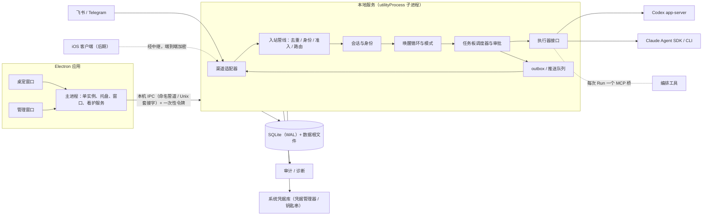

# 架构与模块边界

状态：设计提议，2026-11-20 合并架构草案 v0.2；关键取舍见 [ADR 0002](../adr/0002-process-topology-and-task-board.md)。本文不是已实现或已验证的功能，所有接口、参数和默认值都待 P0 实测。

## 摘要与范围

PalDock 采用「Electron 外壳 + 本地服务子进程」结构：渠道、会话、编排、策略、执行器监管和存储都在本地服务内，桌宠和管理窗口只是可关闭的客户端。助手之间不直接对话，一律通过本地服务维护的任务图交接，由确定性代码推进状态。

四层会话、桌宠统筹和协调助手的定位见 [助手会话设计](03-assistant-orchestration.md)，本文不重复展开。非目标：多租户、完全离线、在手机上运行执行器。

## 平台与端

2026-11-20 起架构按多平台设计，不只针对 Windows：

| 端 | 角色 | 运行什么 | 阶段（建议） |
|---|---|---|---|
| Windows 桌面 | 主机 | 完整的 Electron 外壳 + 本地服务 + 执行器 | 首发 |
| macOS 桌面 | 主机 | 同一套代码，平台层换实现 | 紧随 Windows，P1 起 CI 同时构建 |
| iOS | 远程客户端 | 只做查看、对话、审批和通知，不运行本地服务和执行器 | Windows/macOS 稳定后，另起 ADR |

**为什么 iOS 只做客户端**：iOS 不能运行 Electron，App 沙盒不允许常驻后台服务，也不能启动 Codex/Claude CLI 这类子进程，用户的项目文件也不在手机上。所以手机端是「遥控器」：任务、会话、审批的事实仍在用户的电脑上。

**主机之间的关系**：一台电脑一个数据根、一个本地服务。首版不做多台电脑之间的数据同步；同一用户有 Windows 和 Mac 时，各自是独立主机，外部渠道账号只能绑定到一台主机（避免两台同时回复）。

**平台层**：凡是和操作系统相关的能力都放在 `packages/platform` 的接口后面，领域层和应用层不感知平台：

| 能力 | Windows | macOS |
|---|---|---|
| 本机 IPC | 命名管道（`\\.\pipe\paldock-<随机>`） | Unix 域套接字（数据根下，权限 0600） |
| 凭据存储 | Windows 凭据管理器 | 钥匙串（Keychain） |
| 默认数据根 | 首次启动由用户选择，可选 D 盘 | `~/Library/Application Support/PalDock`，可改到其他卷 |
| 开机自启 | `app.setLoginItemSettings` | 同一 API（macOS 13+ 走系统登录项，需实测） |
| 锁屏与空闲 | powerMonitor | powerMonitor（两边事件名一致，需实测） |
| 结束执行器进程树 | Job Object | 进程组 + 信号 |
| 分发与签名 | 代码签名 + 安装包 | Developer ID 签名 + 公证；不上 Mac App Store（沙盒不允许启动 CLI 子进程） |
| 文件访问授权 | 无额外授权 | 访问「文稿」「桌面」等目录会触发系统授权弹窗，需引导用户 |

**iOS 如何连到电脑**（待定，P0 只做调研）：

- 现成路径：用飞书或 Telegram 在手机上和电脑上的 PalDock 对话、审批，不需要额外开发，P2 即可用。
- 原生 App：家里的电脑通常没有可被手机直连的公网地址，需要一个中继。建议参考 Happier 的做法：本地服务主动连出到中继，手机 App 也连到中继，两端端到端加密，中继只转发密文、不存业务数据。设备通过桌面上显示的二维码配对，每台设备可单独吊销。推送通知走 APNs，通知内容只放「有一个待审批」这类摘要，不放消息正文。
- iOS App 在审批路由里视为一个外部渠道：同样受项目远程审批等级 L0–L2 约束，同样以先到者为准。中继服务是新的信任边界和运维成本，是否自建、自托管或不做，需单独 ADR。

## 总体结构



信任边界在本地服务的入口：桌面端靠本机 IPC 令牌认证，外部渠道靠绑定和白名单，执行器只拿到受限工作目录。不开 TCP 端口；将来如需本机浏览器访问，另起 ADR。常驻后台由用户控制。

## 规划中的目录（尚未生成）

```text
apps/desktop/                  Electron 主进程、预加载、管理窗口、桌宠
apps/local-service/            本地服务进程入口、生命周期与恢复程序
packages/domain/               领域模型、状态机与策略接口
packages/application/          会话、任务板调度、审批、唤醒与记忆用例
packages/contracts/            版本化命令、事件、适配器协议
packages/storage-sqlite/       数据访问、迁移、备份与保留期清理
packages/runtime-codex/        Codex app-server 适配器
packages/runtime-claude/       Claude Agent SDK / CLI 适配器
packages/mcp-bridge/           每次 Run 注入的本机 MCP 桥（stdio）
packages/channel-desktop/      桌面聊天入口，与外部渠道走同一管线
packages/channel-feishu/       飞书适配器
packages/channel-telegram/     Telegram 适配器
packages/channel-mock/         本地模拟渠道
packages/platform/             平台接口：IPC、凭据、自启、电源、进程树
packages/platform-windows/     Windows 实现
packages/platform-macos/       macOS 实现
packages/security/             授权、风险分级、凭据、脱敏接口
packages/observability/        安全事件、诊断
packages/ui/                   跨界面组件
tests/contract/                可复用契约测试
tests/integration/             本地服务及适配器集成测试
docs/                          需求、设计、运行与决策
```

iOS 客户端和中继在单独 ADR 定下后再规划目录。

依赖方向：desktop/channel/runtime/storage/mcp-bridge/platform-* → contracts / domain；application 编排端口，不直接依赖供应商 SDK、Electron 或 SQLite。具体框架和包名均为候选，不在未经验证时锁定。

## 桌面宿主

桌面宿主只负责显示和输入，任务的事实都在本地服务里。关闭桌宠、重启窗口或渲染进程崩溃，都不影响正在运行的任务。

| 进程 | 职责 | 不负责 |
|---|---|---|
| Electron 主进程 | 单实例锁、托盘、窗口管理、启动并看护本地服务、系统通知 | 业务状态、凭据、执行器 |
| 桌宠窗口（渲染进程） | 透明顶层窗口、动画、气泡、快速输入、状态提示 | 直接访问 Node 或本地文件 |
| 管理窗口（渲染进程） | 「待我处理」、任务中心、会话列表、审批、自动处理记录单、渠道与助手设置、诊断 | 同上 |
| 本地服务（Electron 子进程） | 渠道、会话、编排、策略、执行器监管、存储、outbox、审计 | 界面渲染 |
| 执行器进程 | Codex app-server、Claude SDK/CLI 等，每个独立子进程，工作目录受限 | 访问 PalDock 数据库 |

**通信链路**：渲染进程 → preload（contextBridge 暴露的白名单方法）→ 主进程 → 本机 IPC（Windows 命名管道 / macOS Unix 域套接字，由平台层提供）→ 本地服务。管道或套接字名含随机后缀，连接时校验主进程启动服务时下发的一次性令牌。协议使用 `packages/contracts` 中带 `schemaVersion` 的命令与事件，持久事件按序号推送，客户端断线后从最后序号续拉。

**服务启动**：主进程用 Electron `utilityProcess.fork` 启动本地服务（备选 `child_process.fork` + `ELECTRON_RUN_AS_NODE`），复用 Electron 自带的 Node，不另带运行时。除 Electron 单实例锁外，数据根目录再放一个含 PID 的锁文件，启动时检查持有者是否存活，防止两个服务写同一个数据库。以后如需「完全退出界面后仍运行」，再评估拆为独立后台程序。

**生命周期模式**（用户在设置中显式选择，默认第一种）：

1. 随界面退出：关闭所有窗口和托盘时，服务先让运行中的 Run 进入 `interrupted`，写入事件后退出。
2. 托盘常驻：窗口可关，服务和渠道继续运行，托盘图标显示是否有任务或审批。
3. 开机启动（P4 以后）：`app.setLoginItemSettings` 带 `--background` 参数，登录后直接进托盘，仍不自动恢复高风险任务。

**崩溃与恢复**：主进程监听服务退出，固定等待 3 秒后重启；5 分钟内崩溃超过 5 次则停止并提示；因数据目录被锁或资源被占用而退出时不重启。正常退出时先发关闭消息，最多等 35 秒再强制结束。服务启动时先跑恢复程序：所有 `running` 的 Run 标记为 `interrupted`，按原生会话 ID 查询执行器能否 resume，不能判定的外部副作用标为 `unknown` 等用户核实。

**电源事件**：监听 `powerMonitor` 的 suspend / resume / lock-screen。恢复后重新排定所有触发器，并检查时区和系统时间是否变化；锁屏与空闲状态同时用于审批升级和推送积压判断（P0-04 在 Windows 和 macOS 上分别实测）。

P1 可先只做管理窗口，桌宠窗口在 P4 接入同一套事件流，不改服务端。

## 聊天渠道适配器

每个外部渠道是一个可单独启停的适配器，只做协议转换；身份、权限和路由全部在公共管线里。桌面聊天也走同一条管线（`channel-desktop`），保证各入口行为一致。

**发布顺序**：P1 只有 `channel-desktop` 和 `channel-mock`；P2 接飞书和 Telegram（先单聊，再开放白名单群聊），这是首版仅有的两个外部渠道。Telegram 用长轮询接入，同时验证渠道契约是否通用，在中国大陆需要代理。钉钉等其他渠道以后酌情增加，复用同一套契约测试。

**入站管线**（每一步失败即拒绝并记审计，不往下走）：

1. 接收与验签：适配器用平台官方长连接或签名校验收事件。
2. 去重：以 `provider + account + event_id` 写入 inbox 表，重复则丢弃。
3. 归一化：转为 `InboundMessage`（发送人、会话、线程、文本、附件引用、引用消息），附件下载到受控目录，文件名重新生成。
4. 身份解析：`ChannelAccount` 查 `Principal` 绑定。未绑定的发送人走配对码流程：机器人回复一个 8 位一次性配对码（1 小时过期，每个渠道账号最多 3 个待处理请求），用户在桌面端确认后才完成绑定；绑定只授予单聊权限，群聊另需白名单。
5. 准入策略：群聊白名单、是否需要 @、该会话可触发的项目范围。
6. 路由：按 `platform + account + tenant + conversation + thread` 找到或创建 `ExternalConversation`，再关联到 PalDock 主会话。
7. 分类：以 `/` 开头的是确定性命令（`/status`、`/cancel`、`/approve` 等），直接调应用服务；其余作为不可信文本交给协调助手。

**入站持久化**：原始事件先落库再处理，inbox 以（队列, event_id）为主键。处理完成后保留墓碑行而不删除，迟到的重复事件直接拒绝，重启后去重依然有效。同一会话的事件串行处理。处理权带租约，进程崩溃后超时的事件由恢复程序回收重做。

**出站**：业务代码只往 outbox 写一条记录（与状态变更同一事务），投递工作器负责限速、分片、重试和回执。平台不支持编辑时，进度更新降级为关键节点消息。发送超时标为 `unknown`，不盲重发。

**飞书适配器要点**：官方 SDK 的 WSClient 长连接，不需要公网地址；订阅 `im.message.receive_v1` 和 `card.action.trigger`。回复一律发成交互卡片，因为只有卡片可以更新；流式输出按 500ms 节流更新同一张卡片，结束时做最后一次更新。群聊默认只响应 @机器人 的消息，@所有人 不算。

## 审批路由与远程审批等级

**桌面优先**：所有审批（包括高风险）都先推送到桌面，不同时发外部渠道。满足以下任一条件时，再把同一个审批发到用户已绑定的飞书单聊：

- 桌面审批在设定时间内无操作（建议默认 3 分钟，可配置）；
- 桌面已锁屏、息屏或系统空闲；
- 桌面 UI 未运行（服务在托盘或后台模式下）。

升级后两端都可以处理，以先到者为准（校验审批版本号），另一端的卡片更新为「已在桌面/飞书处理」。通过外部渠道审批时：只在已绑定的单聊中发送，不发到群聊；点击人必须是有审批权的 Principal；卡片写明操作摘要、目录、发起助手和过期时间；审批一次性、不可重放；审计记录审批来自哪个渠道。普通通知同样桌面优先，只有任务从外部渠道发起时，结果才回到该渠道。

**远程审批等级**（按项目配置）决定升级到外部渠道后能批准哪些风险级别；不允许远程批准的审批，外部渠道只收到「待桌面审批」提醒。

| 等级 | 外部渠道可批准 | 适用 |
|---|---|---|
| L0 仅桌面 | 无，只提醒 | 敏感项目 |
| L1 远程低风险 | 低、中风险 | 新项目默认 |
| L2 完全远程 | 全部，包括高风险 | 用户显式开启 |

**风险分级（草案，待确认）**：低 = worktree 内读写、运行测试；中 = 安装依赖、worktree 内联网；高 = 推送到远端、合并分支、删除或写入 worktree 以外的路径、向外发送消息。分级由策略引擎根据操作类型判定，不采信模型自报。等级只能在桌面设置中修改，外部渠道不能改；变更写入审计。

**授权约束**：「本次允许」绑定到具体的命令、参数和工作目录，换一条命令就要重新审批。「本会话允许」只存在内存里，会话恢复或服务重启后不继承。角色和模式的审批配置只能比项目策略更严，不能更松。没有任何可用的审批入口时默认拒绝。卡片发送失败时，退回为文字命令 `/approve <审批编号> allow-once|deny`。

## 助手角色

角色和执行器分开定义：角色描述「做什么、能碰什么」，执行器描述「由谁来跑」。换执行器不改变权限。

`AgentProfile`（存入数据库，带版本号，可导出为 YAML）：`role`、显示名、职责说明、提示词模板版本；`runtime` 首选执行器及备选；`workspaceAccess`（none / read / worktree-write）；`tools` 白名单（shell、网络、文件写入分别开关）；`approvalPolicy`；`budget`（单次 Run 时长与 token 上限、`maxConcurrency`）。

| 角色 | 职责 | 工作区权限 | 出厂默认执行器（可改） | 引入阶段 |
|---|---|---|---|---|
| 协调助手 | 项目总览、拆任务、派单、汇总、对用户回复；也可自己动手 | 按项目授权，不额外限制 | 第一个可用的执行器 | P1 |
| 开发助手 | 在独立 worktree 内实现变更 | worktree-write | Codex | P1 |
| 测试助手 | 编写与运行测试，提交可复现证据 | worktree-write（仅测试目录） | Claude | P3 |
| 审阅助手 | 独立审阅 diff，列出问题与位置 | read | Claude | P3 |
| 文档助手 | 更新文档与变更说明 | worktree-write（仅 docs） | 第一个可用的执行器 | P3 |
| 调研助手 | 检索资料、评估方案、输出调研结论 | read（联网需开启） | 第一个可用的执行器 | P3 |

- **执行器可自选**：每个角色的执行器由用户在设置里选择，可按项目覆盖，派单时也可临时指定；表中只是出厂默认值。唯一硬约束是能力检查：所选执行器必须报告支持该角色需要的能力（工作目录限制、审批、取消等），否则界面提示并拒绝启动。
- **审阅与开发同一执行器**：只做提醒；但审阅必须新开独立会话，不共享开发方的上下文。
- **协调助手不限能力**：PalDock 不对它的工具和具体实现方式做额外约束，它可以自己动手，也可以派单；与其他助手一样受项目授权、审批等级和审计约束，任务状态仍由调度器按事件推进。

**执行器接入方式**（来自参考项目源码，实际参数以本机安装版本在 P0-01 / P0-02 / P0-07 实测为准）：

| 执行器 | 接入 | 会话恢复 | 审批 |
|---|---|---|---|
| Codex | `codex app-server --listen stdio://`，按行分隔的 JSON-RPC；initialize → thread/start 或 thread/resume → turn/start，中断用 turn/interrupt | 存 thread ID，恢复失败则新建 thread | 服务端请求，回复 accept / acceptForSession / decline / cancel |
| Claude（首选） | 官方 Agent SDK，流式输入 | SessionStart 拿 session ID，用 resume 恢复 | PermissionRequest hook |
| Claude（备选） | CLI `-p --output-format stream-json --input-format stream-json` | `--resume <id>` | `--permission-prompt-tool stdio` |
| 其他 CLI（P0-07 评估） | ACP（Agent Client Protocol） | session/load | ACP 权限请求 |

## 助手间编排（任务板）

协调助手提出计划，确定性的调度器推进任务图，专业助手之间不互发消息。所有交接都是任务图上的结构化记录，可审计、可恢复，也避免与执行器原生子代理形成双层分派。

1. 规划：协调助手调用 `propose_plan`，提交子任务列表（角色、目标、验收标准、依赖、允许目录）。服务校验角色存在、依赖无环、目录在项目内、预算未超。
2. 确认：计划显示在任务中心（或渠道卡片），用户确认后进入 `queued`。简单任务可由协调助手判定跳过确认和审阅，但每次跳过都写入自动处理记录单；拿不准时优先问用户。
3. 调度：只派发依赖已满足的子任务，遵守并发上限。写入型子任务先创建独立 git worktree 和分支。
4. 执行：为子任务创建或复用 AgentSession，启动一次 Run。上下文只传目标、验收标准、上游交接记录和必要文件路径，不传整段聊天记录。
5. 审批：执行器发出的审批请求转为 Approval，按角色策略和远程审批等级自动拒绝、自动批准或等用户；超时即拒绝。
6. 交付：助手调用 `submit_result`，提交 [04](05-ai-collaboration.md) 格式的交接记录（变更、验证命令与结果、风险），子任务只能进入 `review`。
7. 验收闸门：服务自己重新运行声明的验证命令或检查 diff，结果与声明不符则子任务为 `failed`。模型说「完成」不会推进状态。
8. 审阅与合并：需要审阅的子任务派给审阅助手；合并 worktree 分支是单独的、需要用户审批的操作。
9. 汇总：全部子任务结束后，协调助手生成总结，经 outbox 回到发起渠道。

**MCP 桥**：本地服务为每次 Run 启动一个本机 MCP 桥（stdio 脚本，经命名管道连回本地服务），作为 MCP 服务器注入 Codex/Claude 会话。桥只暴露该角色允许的工具（协调助手拿到编排工具，专业助手只拿到 `submit_result`、读取任务、记忆等）。调用方身份由启动时注入的一次性令牌和 Run ID 确定，不采信模型自报。

**自动处理记录单**：凡是没有经过用户的决定都留一条记录，包括跳过计划确认、跳过审阅、按审批等级或策略自动批准的操作。字段：时间、任务、跳过或自动批准了什么、判定理由、助手与执行器、结果。桌面有单独页面，用户可以事后补审或撤销授权；哪些情况可以自动处理，每一项都可单独自定义。对应 `auto_decisions` 表。

**失败与退回**：子任务失败时，依赖它的子任务进入 `blocked`，协调助手可提出修改计划（重试、换执行器、拆分），修改计划同样要用户确认。自动重试仅限无外部副作用的失败，每个子任务最多一次。审阅或验收不通过时可打回重做，次数不设上限，每次的原因和累计次数记在子任务上。取消任务会取消其所有未结束的 Run。

**上限与护栏**（初始值，可配置，均强制执行）：全局同时最多 10 个模型调用；每个任务最多 4 个并行子任务；同一助手会话串行。开启「自动取下一个待办」时，每天最多 20 次，两次之间至少 2 分钟，子任务 30 分钟无进展视为卡住并提醒用户。

**每次 Run 保留证据**：同一子任务的每次 Run 都是一次独立尝试，各自保留改动、执行的检查及结果、产物和原生会话。审阅或验收的反馈绑定到产生证据的那次 Run；退回重做后旧 Run 的证据仍可查看，新一轮验收默认打开最新的 Run。任务详情按时间列出各次 Run，显示负责角色、实际执行器、会话和产物。

**原生子代理**：允许 Run 内部使用 Codex/Claude 自己的子代理，PalDock 视其为该 Run 的内部细节，只记录能观察到的事件，不当作可派单的助手。

## 待我处理

多个任务同时运行时，用户最需要知道的是「哪件事在等我」。管理窗口首页提供「待我处理」列表，集中显示需要用户行动的事项，每条点击后直达对应的审批、阻塞原因或验收证据。这是 P1 的首个原型（挂在 P1-04），P4 的桌宠只显示同一份计数和入口，例如「1 项审批、1 项待验收」，iOS 和外部渠道卡片也读同一份数据。

- **从业务状态派生，不单独存待办**：列表由当前的 Approval（`pending`）、子任务（`blocked`、`review`）和 Run（执行状态待确认）实时生成，保证与业务状态一致。只有用户的已读状态单独存在 `attention_reads` 表。
- **看过和处理完分开**：「已读」「已审批」「已验收」是三个独立状态。点开只记已读，待办仍在；审批通过、拒绝、过期，或验收完成、退回，才由对应的业务状态让待办消失。
- **重启后恢复**：因为待办从持久状态派生，重启后列表不变，点击仍定位到同一个对象。
- **验收场景**（用模拟执行器）：任务 A 停在审批，任务 B 交付一个带检查结果的产物。从列表打开 A 后退出，A 仍待审批；重启应用，两条待办都能定位到原对象；拒绝 A 只移除 A 的待办；退回 B 并重跑后，旧结果仍可查看，新结果成为当前验收对象。

## 模式、唤醒与记忆

同一个主会话可以在多种模式之间切换；每一轮都由一个唤醒事件触发，上下文由本地服务按预算从 SQLite 组装。Claude/Codex 的原生压缩只在单次 Run 内使用，不是事实来源。

### 模式

每种模式是一个 `ModeProfile`：人设与提示词、可用工具、可派的角色、允许的触发方式、主动程度。模式只能收窄权限。

| 模式 | 用途 | 工具与派单 | 主要触发 | 阶段 |
|---|---|---|---|---|
| 项目协作 | 委派开发、测试、文档任务 | 全部编排工具，可派单 | 用户消息、任务事件 | P1 |
| 任务提醒 | 待办、截止日、周期事项 | 只能读写提醒 | 触发器到点 | P1 |
| 项目监管 | 巡检任务超时、CI、PR、异常 | 只读，不派写入型子任务 | 定时巡检、外部事件 | P2 |
| 沟通 / 发散 | 讨论新项目、评估方案 | 无执行工具，可联网检索（需开启） | 用户消息 | P2 |
| 陪伴 / 游戏 | 新闻简报、桌宠互动、小游戏 | 联网读取、桌宠动作，不碰项目 | 定时、桌宠事件 | P4 |

### 用户状态与推送队列

主动消息受每天条数上限、免打扰时段、允许推送的渠道（默认只有桌面）约束。普通消息（进度、结果、提醒、陪伴内容）进入 `notification_queue`，按用户状态放行或积压，到期后合并为一条摘要：

| 状态 | 普通消息 | 示例默认值（可自定义，待确认） |
|---|---|---|
| 在线 | 即时推送 | — |
| 忙碌 | 积压后合并推送 | 每 30 分钟一次 |
| 免打扰 | 积压到状态结束 | 手动结束或到设定时间 |
| 空闲 / 锁屏 | 积压，回到电脑前推送摘要 | 空闲 10 分钟即进入 |

审批请求和需要用户决定才能继续的阻塞在任何状态下都立即推送，并按审批路由规则升级。

### 唤醒与触发器

模型不常驻运行。唤醒循环把用户消息、任务事件、触发器到点、外部监听（PR、CI、新闻源）和桌宠事件转为一次唤醒，每次只处理一个事件，记录写入 `wakes` 表并带去重键。协调助手可以用 `create_trigger` / `cancel_trigger` 为自己安排下次检查，同样受策略校验。

`triggers` 字段：一次性或 cron 表达式、目标会话、模式、说明、下次触发时间、`active_hours`（可跨午夜）、`idle_only`、`target`（主会话或隔离会话）、`delivery`（桌面、指定渠道或不推送）。模型回复约定的 `NO_REPLY` 时这次唤醒不推送。休眠或关机期间错过的触发只补最近一次，且距今不超过 12 小时。

单次唤醒上限分两档（可按模式配置）：软上限 20 次模型请求时提醒模型收尾，硬上限 40 次强制停止并告知用户。

### 记忆分层

| 层 | 内容 | 存放 | 写入方式 |
|---|---|---|---|
| 原始记录 | 全部消息、事件 | messages、events，FTS5（trigram，支持中文） | 自动，只追加 |
| 会话摘要 | 每个会话的滚动摘要 | session_summaries | 超过长度阈值时生成，保留历史版本 |
| 长期记忆 | 偏好、项目事实、决定 | memories（范围、主题、正文、来源、更新时间） | 模型提议，按主题更新；用户可查看和删除 |
| 语义检索（P2） | 消息、记忆、文档的向量 | sqlite-vec，仍在 paldock.db | 后台生成 |

- 长期记忆分范围（全局、用户、每个助手、每个项目），每个范围设字数上限；助手只能写被授权的范围，写入前扫描注入模式。会话接近上下文上限时，先让模型静默地把要点写入长期记忆，再生成摘要。
- 分阶段：P1 只做 FTS5 关键词检索；P2 加 sqlite-vec + 本地嵌入模型 bge-small-zh-v1.5（512 维，在独立 utilityProcess 中运行，正文不离开本机），混合排序从向量 0.7 / 关键词 0.3 起步并做时间衰减；按段落切块，每块最多 400 字，重叠 50 字，检索取前 8 条。
- 每次唤醒的上下文按顺序填充，超预算截断后面的层：模式说明与策略边界 → 相关长期记忆 → 当前会话最新摘要 → 最近 N 条消息和本次事件 → 检索到的历史片段。
- 不只依赖原生压缩的原因：压缩内容 PalDock 读不到也改不了；切换执行器后上下文断开；原生会话可能过期。原生 resume 和压缩只用于单次 Run 内的长任务。

## 核心模型

`Workspace` 项目与根目录、远程审批等级；`Principal` 人类身份和授权绑定；`ChannelAccount` 平台账号；`ExternalConversation` 渠道会话；`AgentProfile` 角色、执行器偏好、资源与权限；`AgentSession` PalDock 助手会话及原生会话映射；`Task` 目标和生命周期；`Subtask` 负责角色、依赖、结果；`Run` 单次执行；`Approval` 请求、主体、风险级别、范围和时效；`Message` 来源与目的；`Artifact` 产物引用；`Event` 有序、可回放的状态变化；`ModeProfile`、`Trigger`、`Wake`、`Memory`、`AutoDecision` 见上文；「待我处理」是派生视图，不是独立实体。

最小关联：外部 `platform + account + tenant + conversation + thread` 映射产品会话；产品会话包含任务；任务包含子任务；每个执行助手的 session 与 runtime 原生会话 ID 分别存储。跨渠道会话绑定由用户显式授权，不能只凭群名称判断。

## 状态与幂等

Task：`draft → queued → running → waiting_approval / waiting_dependency / blocked → succeeded / failed / cancelled`。Subtask 另有 `review`：助手交付后只能置为 `review`，由验收闸门或用户推进到 `succeeded`。Run 可被恢复程序置为 `interrupted`；本地服务仍在运行但与执行器的连接断开时，Run 进入「执行状态待确认」（`unconfirmed`），界面如实显示，重新查到原生会话状态后再更新为运行中、完成或失败，不猜测结果。允许的恢复和重试由事件驱动并校验状态版本。Approval：`pending → approved / denied / expired / cancelled`；审批绑定主体、任务、操作摘要和有效期，重放不可复用。

**写入规则**：任何状态变更 = 更新状态表（校验 `version`）+ 追加 events + 必要时写 outbox，在同一事务内完成。界面和渠道都从 events 订阅。这是「状态表为准、事件用于推送和回放」的轻量做法，不是完整事件溯源。

**两类事件**：持久事件（状态变化、消息、审批）带全局序号写入 events，断线后可按序号重放；临时事件（流式输出片段、打字中、桌宠动画、用量心跳）只在内存中广播，不入库、不重放。流式输出在 Run 结束或到达检查点时合并为一条持久消息。

消费者以 `provider + account + event_id` 去重；外发使用 outbox 和投递记录。外部副作用在超时后标记 `unknown` 并核实，不盲目重试；不承诺全链路 exactly-once。

## 本地存储

所有业务数据放在用户首次启动时选定的数据根目录（Windows 可选 D 盘，macOS 默认 `~/Library/Application Support/PalDock`），只有本地服务进程写数据库；凭据单独放在系统凭据库（Windows 凭据管理器 / macOS 钥匙串），不进数据根。

```text
<数据根>/
  paldock.db            SQLite，WAL 模式，单写者
  paldock.lock          含 PID 的服务锁文件
  paldock.sock          macOS 的本机 IPC 套接字（Windows 用命名管道，不落盘）
  config.json           非敏感设置（生命周期模式、启用的渠道）
  artifacts/            产物与渠道附件，文件名由服务生成
  worktrees/            写入型子任务的 git worktree（默认位置）
  logs/                 脱敏日志，按天轮转
  backups/              升级前自动备份与手动备份
```

用户的业务项目不在数据根内，Workspace 只记录其路径。worktree 默认放在数据根，不污染用户目录；依赖相对路径引用项目外目录的工程可能因此构建失败，允许按项目改为放在项目旁边。P0-04 验证 Windows 长路径、杀毒软件扫描，以及 macOS 默认不区分大小写的文件系统对 git 的影响。

| 分组 | 表 | 说明 |
|---|---|---|
| 项目与身份 | workspaces（含 remote_approval_level）、principals、channel_accounts、principal_bindings | 外部账号到用户的绑定及授权范围 |
| 会话 | external_conversations、sessions、runtime_sessions | sessions 用 kind（main/agent）和 parent_id 表达层级；原生 ID 单独存 |
| 角色与模式 | agent_profiles、mode_profiles | 带版本号，历史版本保留 |
| 任务 | tasks、subtasks、subtask_deps、runs、approvals（含 risk_level、escalated_at、decided_via）、handoffs、auto_decisions | 带 version 列做乐观并发控制；反馈记在对应 run 上 |
| 待我处理 | attention_reads | 只存用户已读状态，待办本身由业务状态派生 |
| 消息与产物 | messages、artifacts | 产物只存文件引用 |
| 唤醒与记忆 | triggers、wakes、session_summaries、memories、可选向量表 | 见「模式、唤醒与记忆」 |
| 事件与投递 | events、inbox、outbox、notification_queue | events 全局递增序号，与状态表同事务写入 |
| 审计与维护 | audit_log、schema_migrations | 审计不含秘密和消息正文 |

**备份与迁移**：迁移前用 SQLite online backup 备份到 `backups/`，迁移单向递增；手动导出包含数据库与 artifacts，不含凭据。

**加密与保留期**：数据库不加密，依靠操作系统账户和数据根目录权限保护；凭据只存在系统凭据库。保留期按类别可单独调整：对话正文、摘要和长期记忆默认不自动删除（它们是记忆检索的来源）；工具调用结果和终端输出 7 天；渠道附件和未被任务引用的产物 30 天；诊断日志 14 天。用户可按会话或项目手动删除，删除时同步清理全文索引和向量。

**容量估计**（粗略，未实测）：纯文本消息即便每天数百条，一年也在几十 MB 级别；向量和附件更大，附件放在 `artifacts/`。

## 适配器契约（设计草案）

- Channel：`start / stop / health`；`onInbound(raw) → InboundMessage`；`send(OutboundMessage) → DeliveryReceipt`；`capabilities()` 声明是否支持编辑消息、卡片按钮、附件、话题线程、单条长度上限；事件去重键与错误分类；渠道回执和重试语义按平台分别实现。
- Runtime：`discover / start / resume / send / cancel / respondApproval / health`；事件包含 session ID、run ID、序号、时间与类型，区分输出、工具、审批、完成、失败和中断。调用方持久化原生 ID；不保证所有供应商都支持相同事件或原生 UI 共享。
- Storage：迁移和事务、事件追加、任务并发版本控制、保留期清理、敏感字段脱敏；附件以受控文件引用存储，数据库不保存明文密钥。
- Capability：执行器显式报告恢复、流式、审批、取消、附件、工作目录等能力；角色派单前据此检查，缺失则 UI 提示并采用安全退化，而非伪装成功。

## 端到端示例

用户在飞书单聊里发「给登录页加记住我，并补测试」：

1. 飞书适配器收到事件，inbox 去重后解析出已绑定的 Principal，路由到该单聊对应的主会话。
2. 协调助手提出两个子任务：A 开发（开发助手 / Codex），B 测试（测试助手 / Claude，依赖 A）。
3. 计划以卡片发回飞书，用户点击确认；桌面任务中心同步显示。
4. 调度器为 A 创建 worktree，启动 Codex Run；持久事件写入 events，桌宠显示「开发中」。
5. Codex 请求安装依赖（中风险），先在桌面弹出审批；用户 3 分钟无操作或已锁屏，审批升级到飞书单聊（项目为 L1，可远程批准中风险），用户在飞书批准后桌面弹窗自动关闭。
6. A 提交结果，服务重跑声明的编译命令通过，A 为 `succeeded`，B 解除阻塞。
7. B 在同一分支的新 worktree 中补测试并运行，服务重跑测试确认通过。
8. 协调助手汇总变更和测试结果，经 outbox 回复飞书；合并分支为高风险操作，由用户在桌面审批。

若第 4 步时电脑重启：服务启动后 A 的 Run 标为 `interrupted`，按 Codex thread ID 尝试恢复；恢复失败则提示用户选择重跑或放弃。

## 协议和兼容

应用内部事件与数据结构带 `schemaVersion`；SQLite 迁移单向递增，升级前备份，回滚策略和兼容矩阵在实现时验证。适配器锁定、检测供应商版本；第三方认证、套餐及服务条款单独核验。Higress 是可选模型网关，不假定能代理 Codex / Claude 的订阅或所有协议；Responses、Chat Completions、工具和图片必须分别验证。探针仅为可选观测/集成适配器，不是产品核心依赖。

## 参考项目来源

以上多项具体做法来自 2026-11-20 对 Coopanion、AionUi、Happier、OpenClaw、Orkas 的源码浅读（只读、未运行；Coopanion 的 Cortico 子模块未能核实），以及同日 Codex 对 cmux、Vibe Kanban、Multica、AIRI 官方文档与仓库的调研（未安装实测）。Coopanion 为 AGPL-3.0+，只借鉴设计，不复制代码。

| 做法 | 来源 |
|---|---|
| utilityProcess / ELECTRON_RUN_AS_NODE 启动服务；3 秒重启、5 分钟 5 次停止；35 秒退出等待；PID 锁文件 | AionUi、Coopanion、Happier |
| powerMonitor 恢复后重排触发器；`--background` 自启 | AionUi、Orkas、Coopanion |
| 飞书 WSClient + 卡片流式更新 500ms 节流；群聊必须 @ | AionUi、OpenClaw |
| inbox 墓碑去重、会话串行、租约回收；配对码 | OpenClaw |
| Codex app-server stdio JSON-RPC；Claude Agent SDK / stream-json | Happier、Orkas |
| 本次允许绑定命令；会话授权不继承；只能收紧；`/approve` 文字回退 | OpenClaw、Orkas |
| 每次 Run 的 MCP 桥与令牌身份 | AionUi Team MCP、Orkas bridge |
| 子任务 `review` 状态；并发 10/4/串行；自动推进 20 次/2 分钟/30 分钟 | Orkas |
| 持久事件与临时事件分离 | Happier |
| FTS5 trigram + sqlite-vec 混合检索、时间衰减、压缩前刷入记忆 | OpenClaw |
| bge-small-zh-v1.5 本地嵌入、400 字切块、12 小时只补最近一次 | Orkas |
| 触发器 active_hours / idle_only / NO_REPLY；唤醒软硬上限 20/40 | OpenClaw、Coopanion |
| 通知绑定到具体任务、横幅消失后仍可定位；已读与处理完分开 | cmux |
| 反馈绑定到产生证据的那次尝试，旧尝试保留 | Vibe Kanban |
| 执行器断线但服务显示 running 的故障，转为「执行状态待确认」恢复测试 | Multica（issue #8272） |
| 桌宠作为独立呈现层，订阅状态，换形象不动服务端 | AIRI |

不照搬：助手核心放在 Electron 主进程（AionUi、Orkas），界面崩溃会带走任务；本机 HTTP 端口（Coopanion），需要额外的 Host/Origin 校验；JSON 文件作主存储（Orkas），缺少事务和事件序号；模型在输出里写标记创建定时任务（AionUi），改用经策略校验的工具调用；渠道会话直接自动批准（AionUi），等于没有远程审批。

## 待确认事项

- 风险分级草案和 3 分钟升级等待时间。
- 各角色的出厂默认执行器（与[项目演进总表](../roadmap.md)「待用户决策」中的「Claude 安装与额度」相关）。
- 各用户状态的默认积压时长。
- macOS 进入哪个阶段（建议 P1 起 CI 同时构建，功能与 Windows 同步）；iOS 原生客户端是否做、何时做，以及中继方案（单独 ADR）。
